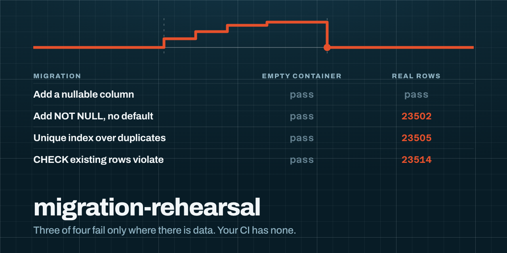

# migration-rehearsal

[](https://github.com/damson/migration-rehearsal/actions/workflows/ci.yml)
[](LICENSE)
[](#running-it-yourself)
[](#faq)

**Most CI tests migrations on an empty database. Most migrations fail because of
the rows already there.**

This repository fixes that. On each pull request, it:

1. applies the pull request's migrations to a real staging database,
2. inside a transaction that is always rolled back,
3. proves the rollback happened,
4. and blocks the pull request if the real rows break the migration.

Nothing is kept. Most of the code here exists to prove that.

**[Read the article](docs/rehearsing-migrations-against-real-rows.md)** for the
full reasoning. It starts with a plain-language primer.

## Contents

- [The problem](#the-problem)
- [How it works](#how-it-works)
- [Adopt it in five steps](#adopt-it-in-five-steps)
- [Is this safe?](#is-this-safe)
- [Files](#files)
- [Adapting it](#adapting-it)
- [Running it yourself](#running-it-yourself)
- [FAQ](#faq)
- [What has been tested](#what-has-been-tested)
- [Contributing](#contributing)
- [Licence](#licence)

## The problem

Four migrations, each run twice: once on an empty Postgres, as most CI does, and
once on a database with real rows.

| Migration | Empty database | Database with rows |
|---|---|---|
| Add a nullable column | passes | passes |
| Add `NOT NULL` with no default | **passes** | fails, `23502` |
| Create a unique index over duplicates | **passes** | fails, `23505` |
| Add a `CHECK` that existing rows violate | **passes** | fails, `23514` |

Three of the four fail only when there is data. An empty table breaks no rule,
because it holds nothing.

So the green tick is misleading. The pull request merges, and the migration fails
later, on the merged code.

## How it works

```sql
begin;
savepoint rehearsal_root;
  -- every migration this branch has that the target has not applied yet
rollback to savepoint rehearsal_root;
rollback;
```

In Postgres, schema changes such as `CREATE TABLE` and `ALTER TABLE` can run
inside a transaction, and a rollback undoes them. So a migration can run in full
against real rows, then be undone without being saved.

The savepoint is a marker inside the transaction. If a migration sneaks in a
`COMMIT`, the marker disappears, the rollback to it fails, and the run raises an
alarm instead of keeping the changes.

## Adopt it in five steps

1. **Pick a target**: a staging or preview database with realistic rows. Never
   production. The tool refuses production.
2. **Copy `reference/rehearsal.ts` and `reference/run-rehearsal.ts`** into your
   repository, for example into `tools/migration-rehearsal/`.
3. **Copy `reference/rehearse-migrations.yml`** into `.github/workflows/` and
   fill in the placeholders. See [Adapting it](#adapting-it).
4. **Store the database credential** as a secret on a GitHub deployment
   environment, and name that environment in the workflow.
5. **Copy `reference/rehearsal-selftest.yml` and watch it pass.** It shows the
   check failing when it should. Only then make the rehearsal a required check.
   For a filled-in example, see `.github/workflows/selftest.yml`.

## Is this safe?

The rehearsal runs your pull request's SQL on a live database. Four guards make
that safe, in this order:

1. **Wrong target: refused**, before connecting. Production is never allowed,
   and an unknown connection string is refused.
2. **`commit` or `rollback` in a migration: refused**, before connecting. Either
   would end the transaction and keep the changes.
3. **Savepoint check.** A hidden `COMMIT` destroys the savepoint, so the run
   fails loudly.
4. **Before-and-after count.** The tool counts the database's objects before and
   after, and compares them.

Guards 3 and 4 check different things on purpose. Guard 3 asks the transaction
whether it stayed intact. Guard 4 asks the database what is actually there.

The article covers each guard in detail, including what each one cannot catch.

## Files

| File | What it is |
|---|---|
| `docs/rehearsing-migrations-against-real-rows.md` | The article, with a primer for newcomers. |
| `reference/rehearse-migrations.yml` | The pull request check, with placeholders for your values. |
| `reference/rehearsal-selftest.yml` | A self-test against a throwaway Postgres, proving the check can fail. |
| `reference/rehearsal.ts` | Every decision the rehearsal makes. |
| `reference/run-rehearsal.ts` | The wiring: environment, files, Postgres client, output. |
| `reference/rehearsal.test.ts` | 32 tests over `rehearsal.ts`, using a fake database driver. |
| `tools/check-placeholders.mjs` | Checks that the workflows and this README agree. Runs in CI. |
| `tools/readability.mjs` | Measures how readable the article is. Runs in CI. |
| `.github/workflows/selftest.yml` | The self-test, filled in and running in this repository. |
| `examples/migrations/` | Two small migrations for the self-test to use. |

`rehearsal.ts` and `run-rehearsal.ts` are separate so that tests can import the
logic without starting the whole job.

## Adapting it

Every value you must change is written in angle brackets. A copy you forgot to
finish fails loudly instead of touching the wrong database.

| Placeholder | What to put there |
|---|---|
| `<MIGRATIONS_DIR>` | Where your migration files live, for example `supabase/migrations`. |
| `<REHEARSAL_DIR>` | Where you copied `rehearsal.ts` and `run-rehearsal.ts`. |
| `<REHEARSAL_ENVIRONMENT>` | The GitHub deployment environment holding the credential. |
| `<REHEARSAL_DB_URL_SECRET>` | The name of the secret holding the database connection string. |
| `<EXPECTED_PROJECT_REF>` | The name of the variable naming the one database the rehearsal may touch. |
| `<NODE_VERSION>` | The Node version for the runner, for example `22`. |
| `<SECRETS_DOC>` | Where your setup notes live. It is shown when the credential is missing. |
| `<PRELUDE_SQL>` | Self-test only. SQL to create the roles and schemas your hosting provider normally supplies. Delete the step if your migrations only touch `public`. |

Three parts of `rehearsal.ts` depend on your migration tool. Each is marked at the
top of the file:

- **`LEDGER_QUERY`** reads which migrations are already applied. The reference
  reads Supabase's `supabase_migrations.schema_migrations`. Flyway's
  `flyway_schema_history`, Liquibase's `databasechangelog` and Django's
  `django_migrations` drop in the same way.
- **`versionOf`** reads a version number from a filename. If it can read no
  version from any file, the run refuses. Otherwise a different naming scheme
  would skip every file and report nothing to do.
- **`projectRefFrom`** reads a database name from a connection string. It must
  return null for any string it does not recognise, so an unknown database is
  never treated as a match.

## Running it yourself

You need Node 22.12 or newer. Node 23 and 25 are not supported by the test runner.

```sh
git clone https://github.com/damson/migration-rehearsal.git
cd migration-rehearsal
npm install
npm run verify   # type check, tests, placeholder and readability checks
```

To run the rehearsal against a database by hand:

```sh
REHEARSAL_TARGET_DB_URL=... \
REHEARSAL_EXPECTED_PROJECT_REF=... \
REHEARSAL_MIGRATIONS_DIR=path/to/migrations \
  npm run rehearse
```

It writes nothing to the database.

## FAQ

**Do I need Supabase?**
No. Only the query that reads applied migrations is Supabase-specific, and it is
a one-line change for Flyway, Liquibase, Django or your own table. The rest is
plain Postgres.

**Does this touch production?**
No. It checks the target before connecting, and refuses anything it does not
recognise. Use staging or a preview database.

**What if my staging database has no realistic data?**
Then it catches nothing, and says so. The value comes from the rows. A staging
database restored from a production sample is the usual fix.

**What about pull requests from forks?**
GitHub does not give secrets to fork pull requests, so the rehearsal cannot run
there. The workflow says so clearly instead of passing. The article explains why
`pull_request_target` is not a safe workaround.

**Will it slow my pipeline down?**
By about a minute, and only on pull requests that change a migration. Because the
workflow only runs on those, do not make it a required check on its own: pull
requests that never trigger it would wait for it forever.

**What if a statement cannot run inside a transaction?**
`CREATE INDEX CONCURRENTLY` is the usual case. The rehearsal reports a warning
for it instead of failing the pull request.

**What if my migration tool wraps each file in its own transaction?**
That works. The rehearsal behaves the same way, and stops at the first failure.

## What has been tested

- **The table in [The problem](#the-problem)** comes from running those four
  migrations on an empty database and on a live one, in the project this code
  came from.
- **`rehearsal.ts`** has 32 tests in CI, using a fake database driver.
- **The full rehearsal runs against a real Postgres 17** in this repository's CI,
  on every push and pull request, through `.github/workflows/selftest.yml`.

The latest self-test run:

| Case | Result |
|---|---|
| Nothing new to apply | nothing applied, exit 0 |
| A clean new migration | applied, rolled back, `public` unchanged at 5 objects, and the new table confirmed gone |
| `NOT NULL` over existing rows | `column "rehearsal_nn" of relation "rehearsal_target" contains null values [23502]`, reported as a data problem |
| A migration containing `commit` | refused before connecting |
| A migration containing `end;` | savepoint destroyed (`25P01`), and the escaped table confirmed present, so the alarm was real |
| Override pointing at a remote host | refused, naming the host |
| Local target with no override | refused, so the default is safe |

A fake driver cannot tell whether a constraint would reject a real row. That is
why the self-test checks the database itself, not only the tool's own report.

## Contributing

Contributions are welcome, especially from people who adopted this and hit
something the article does not cover. If a guard is weaker than it claims, please
open an issue.

See [CONTRIBUTING.md](CONTRIBUTING.md) and the
[Code of Conduct](CODE_OF_CONDUCT.md).

## Licence

[MIT](LICENSE), for the article and the code. Copyright 2026 Damien D.

No attribution is required to use the pattern. If you write about it, a link back
is appreciated.
